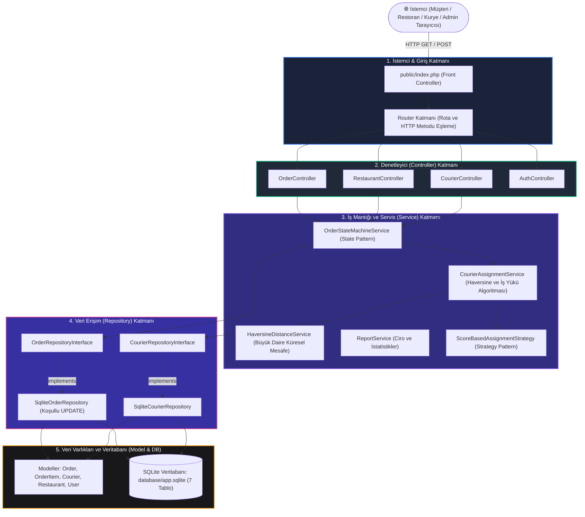
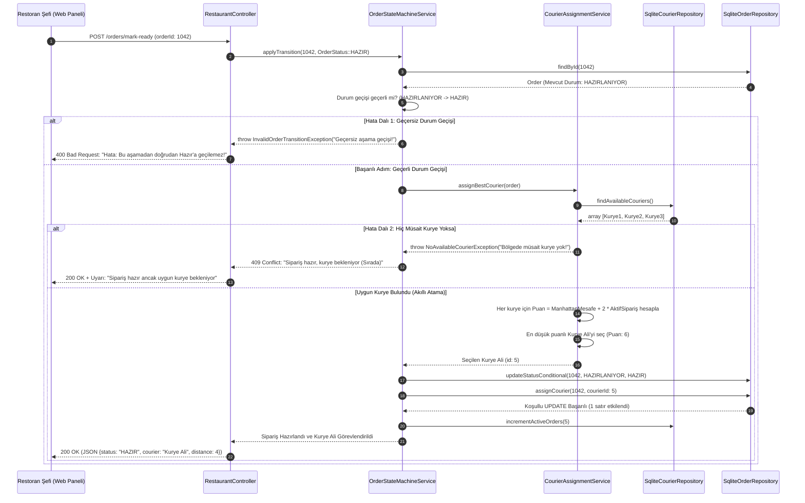
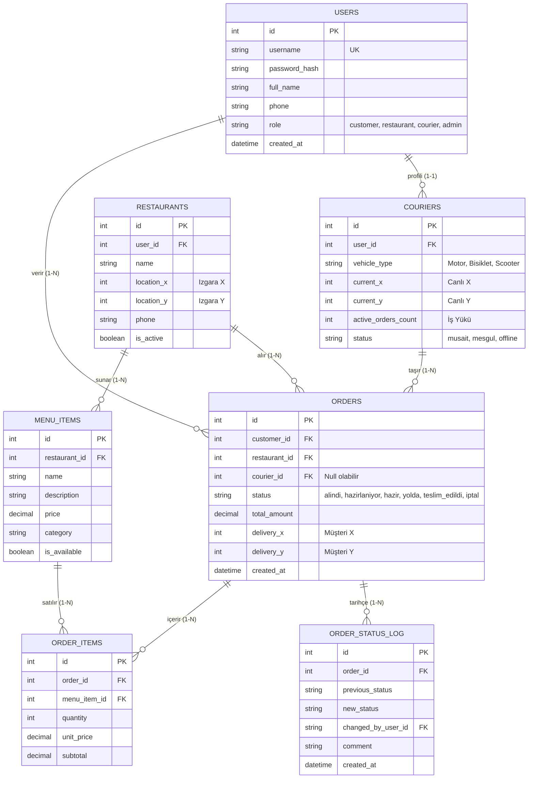
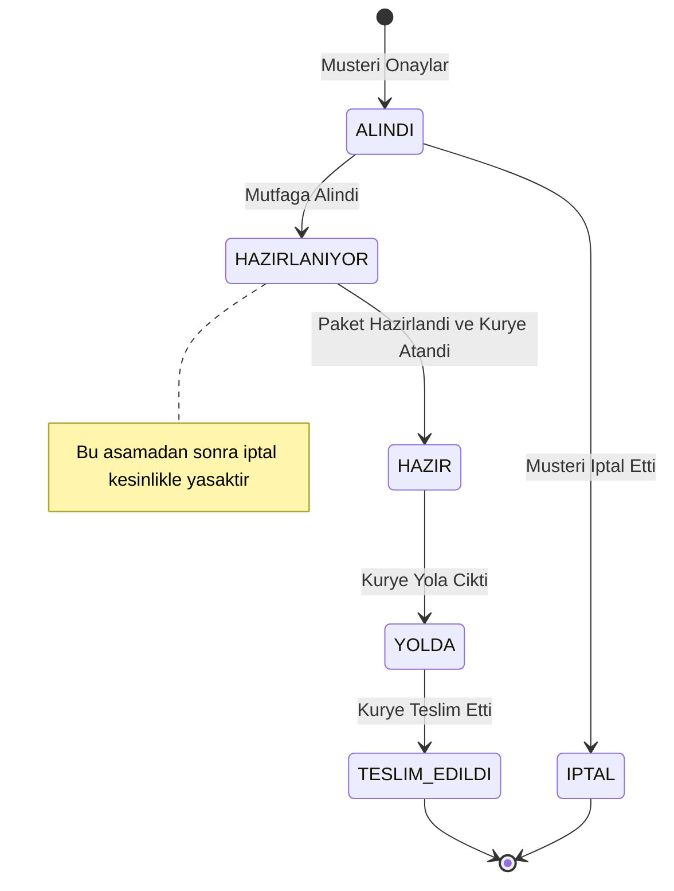
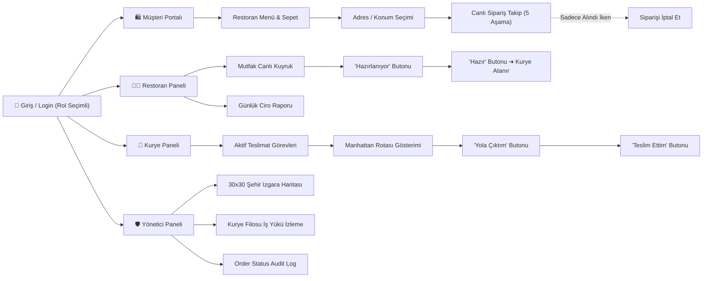

# GustoGo — Yemek Sipariş ve Kurye Takip Sistemi
## Tüm Sistem Diyagramları, Mimari Çizimler ve Sunum Açıklamaları

Bu belgede projenin tüm **UML ve Mimari Diyagramları** (Mermaid formatında) ve her bir diyagramın sunumda nasıl anlatılacağına dair **30 saniyelik özet anlatım rehberleri** yer almaktadır.

---

### 1. 🏛️ Katmanlı Mimari Akış Şeması (Layered Architecture)

İsteklerin sistem içerisindeki tek yönlü akışını ve katmanlar arasındaki izolasyonu gösterir:

> **🎤 30 Saniyede Nasıl Anlatılır?**  
> *"Hocam, burada görüldüğü gibi Front Controller'dan giren istek Router üzerinden ilgili Controller'a gider. Controller kesinlikle SQL çalıştırmaz, sadece Service katmanını tetikler. Servis katmanı State ve Strategy desenlerini kullanarak Repository arayüzleriyle konuşur. Veritabanı değiştiğinde sadece en alttaki somut Repository değişir; iş kuralları etkilenmez."*

---

### 2. 🧩 Sınıf Diyagramı (Class Diagram - 15+ Sınıf)

```mermaid
classDiagram
    class OrderController {
        +createOrder(array cartData) void
        +transitionState(int orderId, string targetStatus) void
        +cancel(int orderId) void
        +trackLive(int orderId) void
    }

    class RestaurantController {
        +kitchenView() void
        +markReady(int orderId) void
        +dailyReport(int restaurantId) void
    }

    class CourierController {
        +myTasks() void
        +startDelivery(int orderId) void
        +completeDelivery(int orderId) void
    }

    class OrderStateMachineService {
        -OrderRepositoryInterface orderRepo
        -CourierAssignmentService courierService
        +canTransition(Order order, OrderStatus newStatus) bool
        +applyTransition(int orderId, OrderStatus newStatus) Order
        +cancelOrder(int orderId) bool
    }

    class CourierAssignmentService {
        -CourierRepositoryInterface courierRepo
        -AssignmentStrategyInterface strategy
        +assignBestCourier(Order order) Courier
        +calculateManhattanDistance(int x1, int y1, int x2, int y2) int
    }

    class HaversineDistanceService {
        +calculate(float lat1, float lon1, float lat2, float lon2) float
        +calculateFromGrid(int x1, int y1, int x2, int y2) float
    }

    class AssignmentStrategyInterface {
        <<interface>>
        +findBestCourier(array candidates, Restaurant r, int targetX, int targetY) Courier
    }

    class ScoreBasedAssignmentStrategy {
        -HaversineDistanceService haversine
        +findBestCourier(array candidates, Restaurant r, int targetX, int targetY) Courier
    }

    class OrderStateInterface {
        <<interface>>
        +proceed(Order order, OrderStatus nextStatus) void
        +canCancel(Order order) bool
    }

    class ReceivedState {
        +proceed(Order order, OrderStatus nextStatus) void
        +canCancel(Order order) bool
    }

    class PreparingState {
        +proceed(Order order, OrderStatus nextStatus) void
        +canCancel(Order order) bool
    }

    class ReadyState {
        +proceed(Order order, OrderStatus nextStatus) void
        +canCancel(Order order) bool
    }

    class OnWayState {
        +proceed(Order order, OrderStatus nextStatus) void
        +canCancel(Order order) bool
    }

    class DeliveredState {
        +proceed(Order order, OrderStatus nextStatus) void
        +canCancel(Order order) bool
    }

    class OrderRepositoryInterface {
        <<interface>>
        +save(Order o) int
        +saveWithTransaction(Order o, array items) int
        +findById(int id) Order
        +getOrderWithDetails(int id) array
        +updateStatusConditional(int id, OrderStatus oldStatus, OrderStatus newStatus) bool
        +assignCourier(int orderId, int courierId) void
    }

    class SqliteOrderRepository {
        -PDO pdo
        +save(Order o) int
        +saveWithTransaction(Order o, array items) int
        +findById(int id) Order
        +getOrderWithDetails(int id) array
        +updateStatusConditional(int id, OrderStatus oldStatus, OrderStatus newStatus) bool
    }

    class CourierRepositoryInterface {
        <<interface>>
        +findAvailableCouriers() array
        +incrementActiveOrders(int courierId) void
    }

    class SqliteCourierRepository {
        -PDO pdo
        +findAvailableCouriers() array
    }

    class Order {
        +int id
        +int customerId
        +int restaurantId
        +int courierId
        +OrderStatus status
        +float totalAmount
        +int deliveryX
        +int deliveryY
    }

    class Courier {
        +int id
        +string name
        +int currentX
        +int currentY
        +int activeOrdersCount
        +CourierStatus status
    }

    OrderController ..> OrderStateMachineService : calls
    RestaurantController ..> OrderStateMachineService : calls
    CourierController ..> OrderStateMachineService : calls
    OrderStateMachineService --> OrderRepositoryInterface : uses
    OrderStateMachineService --> CourierAssignmentService : uses
    OrderStateMachineService --> OrderStateInterface : uses State Pattern
    ReceivedState ..|> OrderStateInterface : implements
    PreparingState ..|> OrderStateInterface : implements
    ReadyState ..|> OrderStateInterface : implements
    OnWayState ..|> OrderStateInterface : implements
    DeliveredState ..|> OrderStateInterface : implements
    CourierAssignmentService --> AssignmentStrategyInterface : uses Strategy Pattern
    ScoreBasedAssignmentStrategy ..|> AssignmentStrategyInterface : implements
    CourierAssignmentService --> CourierRepositoryInterface : uses
    SqliteOrderRepository ..|> OrderRepositoryInterface : implements
    SqliteCourierRepository ..|> CourierRepositoryInterface : implements
    OrderRepositoryInterface ..> Order : returns
    CourierRepositoryInterface ..> Courier : returns
```

> **🎤 30 Saniyede Nasıl Anlatılır?**  
> *"Sınıf diyagramımızda kılavuzdaki en az 12 sınıf kuralını 18 sınıf ve arayüzle karşıladık. Dikkat edilirse Controller sınıfları hiçbir zaman Repository'ye doğrudan erişmez; tüm akış `OrderStateMachineService` ve `CourierAssignmentService` üzerinden yönetilir. State deseni ile 5 durum sınıfı, Strategy deseni ile de puanlama stratejisi arayüzler arkasında modellenmiştir."*

---

### 3. ⏱️ Sıralama Diyagramı (Sequence Diagram - Çekirdek Akış ve 2 Hata Dalı)

> **🎤 30 Saniyede Nasıl Anlatılır?**  
> *"Bu diyagram sistemimizin kalbidir. Restoran siparişi 'Hazır' yaptığında servis önce aşamayı doğrular; sıra dışı geçişlerde Hata Dalı 1 çalışıp HTTP 400 döner. Geçerliyse kurye servisi aranır; boş kurye yoksa Hata Dalı 2 ile sipariş kuyrukta bekletilir. Kurye bulunduğunda Manhattan formülüyle en düşük puanlı Ali seçilir ve koşullu UPDATE ile atomik olarak atanır."*

---

### 4. 🗄️ ER Diyagramı (Entity-Relationship - 7 Tablo)

> **🎤 30 Saniyede Nasıl Anlatılır?**  
> *"Veritabanımız 7 ilişkisel tablodan oluşur. `order_items` tablosu sipariş ile menü arasındaki N-M ilişkiyi çözerek 1NF'yi sağlar. `orders` tablosunda kuryenin veya restoranın adresi, telefonu saklanmaz; yalnızca ID'leri tutularak geçişli bağımlılıklar engellenmiş ve tam 3NF normalizasyonu sağlanmıştır."*

---

### 5. 🔄 Durum Geçiş Makinesi Diyagramı (State Machine Flow)

> **🎤 30 Saniyede Nasıl Anlatılır?**  
> *"Sipariş yaşam döngümüz katı bir durum makinesidir. Görüldüğü üzere iptal oku yalnızca 'Alındı' aşamasından çıkar. Mutfakta pişmeye başlanan veya kuryeye verilen siparişlerde iptal oku yoktur; restoran ve kurye zarara uğratılamaz."*

---

### 6. 🗺️ Sayfa Haritası (Page Map)

