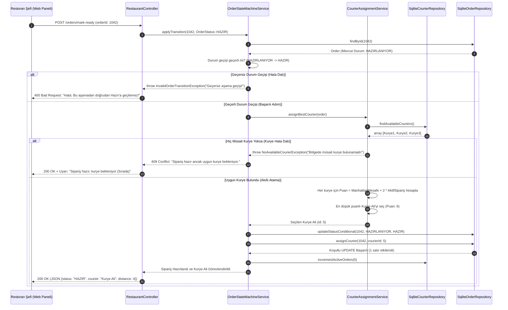
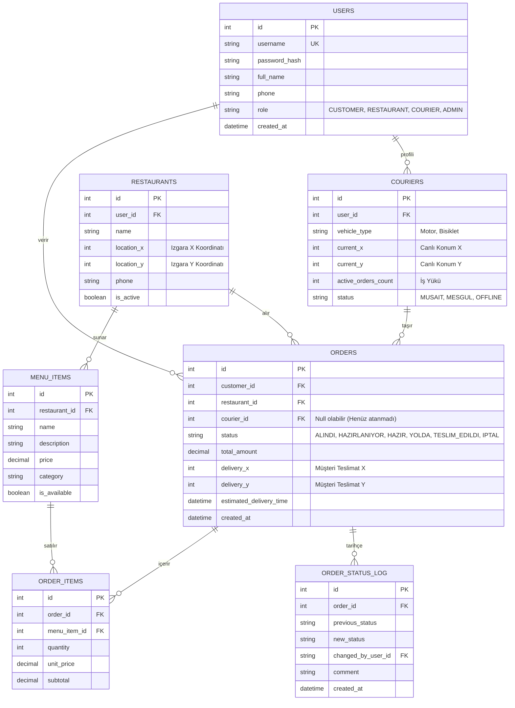
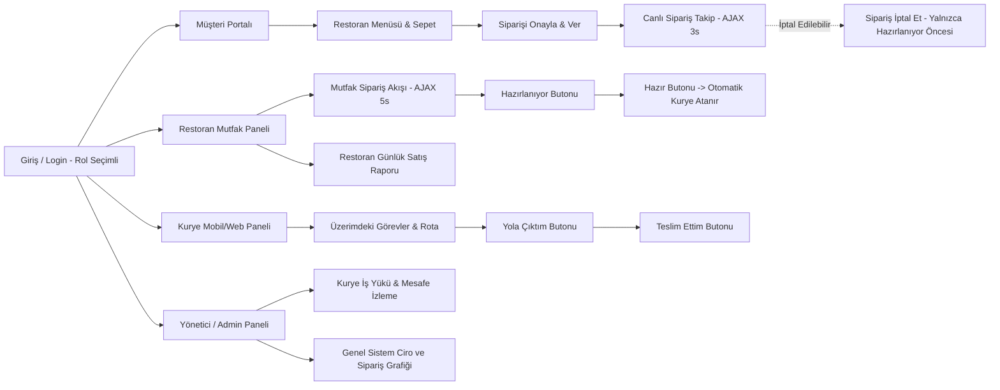
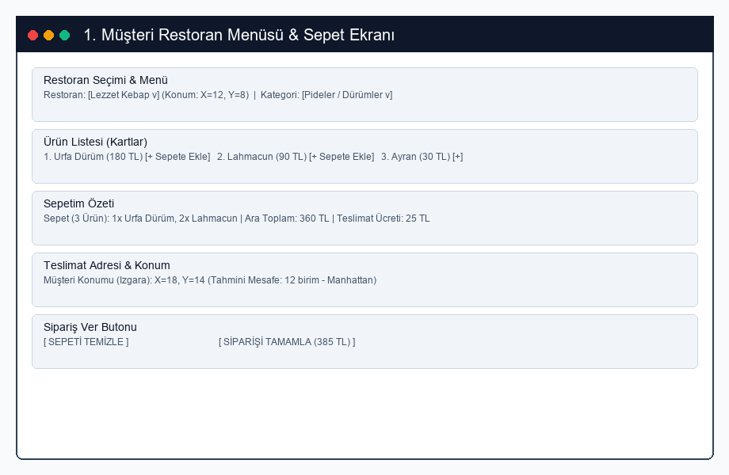
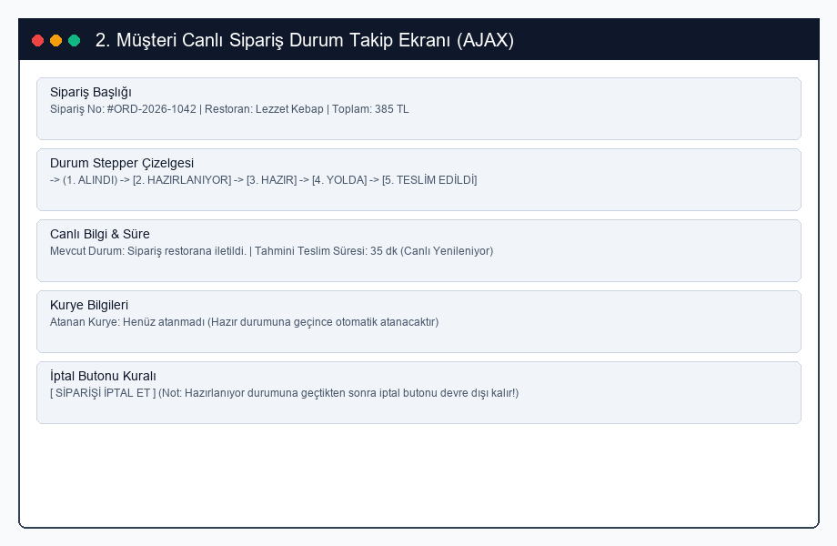
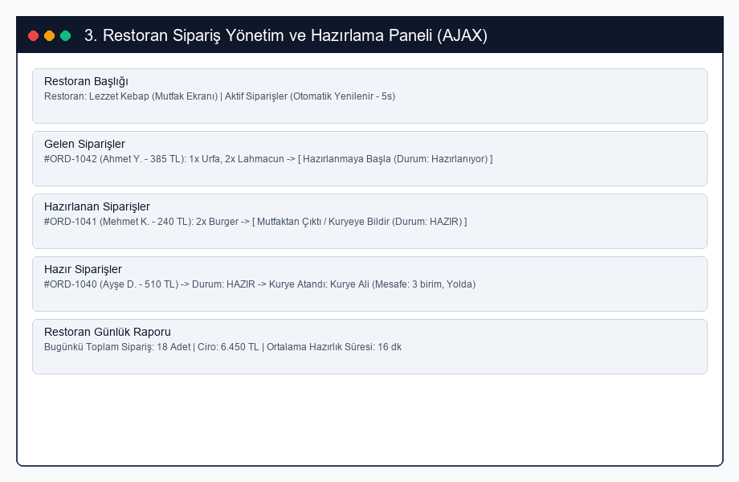
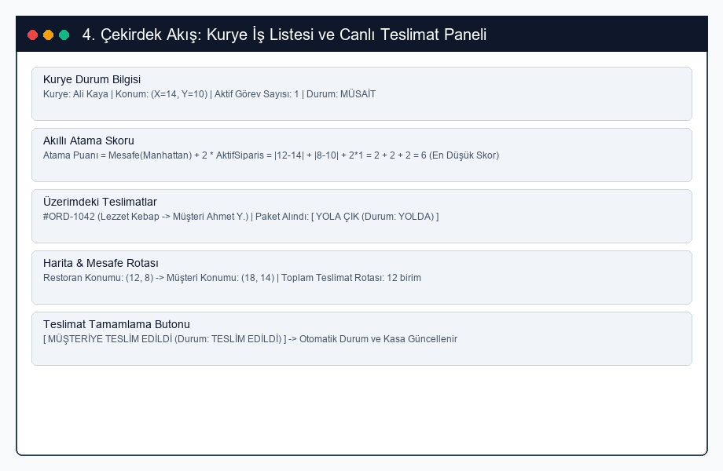
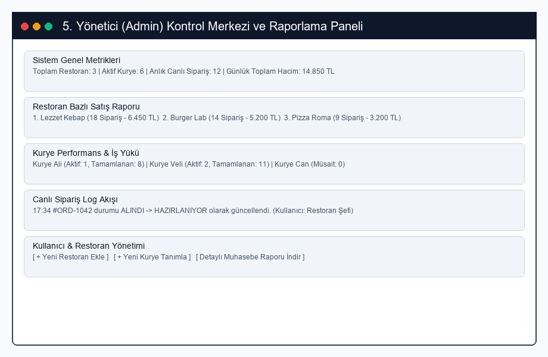

# Yemek Sipariş ve Kurye Takip Sistemi - Tasarım Belgesi

**Ders:** PHP Programlama – Tasarım ve Mimari (Hafta 3)  
**Proje Adı:** Yemek Sipariş ve Kurye Takip Sistemi (Food Delivery & Smart Courier Dispatch)  
**Grup Sorumluları ve Sunum Görev Dağılımı:**
- **Proje Yöneticisi:** @mustafa-nuri-ural (Sunum: Proje vizyonu, çekirdek problem, kullanıcı rolleri ve 3 ana hikâye - 1,5 dk)
- **Yazılım Mimarı:** @mimar-uye (Sunum: Katmanlı mimari, çekirdek sınıflar, State ve Strategy desenleri ve gerekçeleri - 2 dk)
- **Veritabanı & Test Sorumlusu:** @vt-test-uye (Sunum: Kurye atama ve durum sıralama diyagramı, ER diyagramı ve 3NF analizi - 2 dk)
- **Arayüz & Dokümantasyon Sorumlusu:** @ui-doc-uye (Sunum: 5 adet ekran taslağı, sayfa haritası, risk matrisi ve GitHub backlog - 1,5 dk)

---

## 1. Mimari (Katman Şeması ve Klasör Yapısı)

Sistem, **Katmanlı Mimari (Layered Architecture)** prensiplerine harfiyen uygun olarak tasarlanmıştır. Her katmanın kesin ve net bir sorumluluğu bulunup, bir katman sadece doğrudan altındaki katmanla konuşur:  
`public/index.php → Router → Controller → Service → Repository → Model/Database`.

### Katman Sorumluluk Tablosu

| Katman | Görevi | Asla Yapmaz | Bizim Projemizdeki Karşılığı |
| :--- | :--- | :--- | :--- |
| **Router** | URL ve HTTP metoduna göre ilgili Controller metodunu seçer | İş kuralı veya SQL içermez | `POST /orders/transition` → `OrderController::changeStatus` |
| **Controller** | `$_POST`/`$_GET` verilerini karşılar, giriş doğrulaması yapar, Servisi çağırır, JSON/View döner | SQL sorgusu yazmaz, kurye puanı veya sipariş tutarı hesaplamaz | `OrderController`, `CourierController`, `RestaurantController`, `AuthController` |
| **Service** | Çekirdek algoritma, durum makinesi (State Machine), Manhattan mesafe hesabı ve kurye atama mantığı | `$_POST`/`$_GET` doğrudan okumaz, HTML çıktısı üretmez | `OrderStateMachineService`, `CourierAssignmentService`, `ReportService` |
| **Repository** | Veritabanı sorgularını (koşullu UPDATE, JOIN, INSERT) yönetir ve soyutlar | İş kuralı içermez, Controller katmanı ile doğrudan konuşmaz | `OrderRepositoryInterface`, `CourierRepositoryInterface`, `RestaurantRepositoryInterface` |
| **Model** | Veritabanı varlıklarını (Entity) temsil eden saf veri taşıyıcı sınıflardır | Veritabanına doğrudan erişmez, SQL çalıştırmaz | `Order`, `OrderItem`, `Courier`, `Restaurant`, `User`, `MenuItem` |
| **View** | Kullanıcıya HTML/JSON arayüzünü sunar; AJAX ile arka planda veri çeker | Hesaplama yapmaz, veritabanına bağlanmaz | `views/customer/menu.php`, `views/restaurant/kitchen.php`, `views/courier/panel.php` |

> **Kontrol Sorusu Yanıtı:** *"Veritabanını değiştirirsek (örneğin SQLite'tan MySQL veya PostgreSQL'e geçilirse) hangi dosyalar değişir?"*  
> **Cevap:** Yalnızca `src/Repository/` altındaki somut repository sınıfları (`SqliteOrderRepository.php` vb.) değişir. Controller, Service, Model sınıfları ve durum makinesi arayüzlere (`Interface`) bağımlı olduğundan tek bir satır kod bile değişmez.

### Klasör Yapısı

```text
yemek-kurye-sistemi/
├── composer.json                       # PSR-4 otomatik yükleme ve bağımlılıklar
├── .gitignore                          # vendor/, database/*.sqlite, geçici dosyalar
├── public/
│   ├── index.php                       # Front Controller (Uygulamanın giriş noktası)
│   └── js/
│       ├── live-order.js               # Müşteri canlı sipariş AJAX takip betiği
│       └── kitchen-poll.js             # Restoran mutfak paneli canlı sipariş çekme betiği
├── src/
│   ├── Enum/                           # PHP 8.1 Destekli Tip Güvenli Enum'lar
│   │   ├── OrderStatus.php             # ALINDI, HAZIRLANIYOR, HAZIR, YOLDA, TESLIM_EDILDI, IPTAL
│   │   ├── UserRole.php                # CUSTOMER, RESTAURANT, COURIER, ADMIN
│   │   └── CourierStatus.php           # MUSAIT, MESGUL, OFFLINE
│   ├── Controller/                     # İstekleri karşılayan Controller katmanı
│   │   ├── OrderController.php         # Sipariş oluşturma, durum güncelleme, sepet işlemleri
│   │   ├── CourierController.php       # Kurye panel işlemleri ve teslimat bildirimleri
│   │   ├── RestaurantController.php    # Mutfak paneli ve günlük ciro/satış raporu
│   │   └── AuthController.php          # Rol bazlı giriş ve oturum denetimi
│   ├── Service/                        # İş kuralları ve Çekirdek Algoritmalar
│   │   ├── OrderStateMachineService.php # Durum geçişi denetimi ve kural motoru
│   │   ├── CourierAssignmentService.php # Manhattan mesafe + iş yükü kurye atama algoritması
│   │   ├── ReportService.php           # Restoran günlük satış ve kurye performans raporlama
│   │   ├── State/                      # State Tasarım Deseni Somut Sınıfları
│   │   │   ├── OrderStateInterface.php
│   │   │   ├── ReceivedState.php       (Alındı)
│   │   │   ├── PreparingState.php      (Hazırlanıyor)
│   │   │   ├── ReadyState.php          (Hazır)
│   │   │   ├── OnWayState.php          (Yolda)
│   │   │   ├── DeliveredState.php      (Teslim Edildi)
│   │   │   └── CancelledState.php      (İptal Edildi)
│   │   └── Courier/
│   │       ├── AssignmentStrategyInterface.php (Strategy Deseni)
│   │       └── ScoreBasedAssignmentStrategy.php (Puan = Mesafe + 2*AktifSipariş)
│   ├── Repository/                     # Veritabanı Arayüzleri ve Somut Sınıflar
│   │   ├── OrderRepositoryInterface.php
│   │   ├── SqliteOrderRepository.php   (Koşullu UPDATE ve JOIN sorguları)
│   │   ├── CourierRepositoryInterface.php
│   │   ├── SqliteCourierRepository.php
│   │   ├── RestaurantRepositoryInterface.php
│   │   └── SqliteRestaurantRepository.php
│   └── Model/                          # Saf Veri Taşıyıcı Modeller (Entities)
│       ├── Order.php
│       ├── OrderItem.php
│       ├── Courier.php
│       ├── Restaurant.php
│       ├── MenuItem.php
│       ├── User.php
│       └── OrderStatusLog.php
├── views/                              # HTML ve Blade benzeri PHP şablonları
│   ├── customer/                       # Müşteri menü, sepet ve canlı sipariş takip sayfaları
│   ├── restaurant/                     # Restoran mutfak ve günlük ciro rapor ekranları
│   ├── courier/                        # Kurye görev ve harita rota panelleri
│   └── admin/                          # Yönetici genel sistem izleme ve kurye atama denetimi
├── database/                           # SQLite veritabanı dosyası ve DDL şeması
├── docs/                               # Tasarım ve analiz dokümantasyonu
│   ├── tasarim.md                      # Bu tasarım belgesi
│   └── wireframes/                     # 5 adet PNG ekran taslağı
├── storage/                            # Loglar ve geçici veriler
└── tests/                              # PHPUnit testleri (Geçersiz durum geçişi & Kurye puanı testleri)
```

---

## 2. Sınıf Diyagramı (Class Diagram)

Kılavuzdaki **en az 12 sınıf** kuralına tam uyumlu olarak; Controller, Service, Repository, Model, State ve Strategy desen sınıfları modellenmiştir. Katman atlama kesinlikle engellenmiş olup, Controller katmanı doğrudan Repository ile konuşmaz.

```mermaid
classDiagram
    class OrderController {
        +createOrder(array cartData) void
        +transitionState(int orderId, string targetStatus) void
        +cancel(int orderId) void
        +trackLive(int orderId) void
    }

    class RestaurantController {
        +kitchenView() void
        +markReady(int orderId) void
        +dailyReport(int restaurantId) void
    }

    class CourierController {
        +myTasks() void
        +startDelivery(int orderId) void
        +completeDelivery(int orderId) void
    }

    class OrderStateMachineService {
        -OrderRepositoryInterface orderRepo
        -CourierAssignmentService courierService
        +canTransition(Order order, OrderStatus newStatus) bool
        +applyTransition(int orderId, OrderStatus newStatus) Order
        +cancelOrder(int orderId) bool
    }

    class CourierAssignmentService {
        -CourierRepositoryInterface courierRepo
        -AssignmentStrategyInterface strategy
        +assignBestCourier(Order order) Courier
        +calculateManhattanDistance(int x1, int y1, int x2, int y2) int
    }

    class AssignmentStrategyInterface {
        <<interface>>
        +findBestCourier(array candidates, Restaurant r, int targetX, int targetY) Courier
    }

    class ScoreBasedAssignmentStrategy {
        +findBestCourier(array candidates, Restaurant r, int targetX, int targetY) Courier
    }

    class OrderStateInterface {
        <<interface>>
        +proceed(Order order, OrderStatus nextStatus) void
        +canCancel(Order order) bool
    }

    class ReceivedState {
        +proceed(Order order, OrderStatus nextStatus) void
        +canCancel(Order order) bool
    }

    class PreparingState {
        +proceed(Order order, OrderStatus nextStatus) void
        +canCancel(Order order) bool
    }

    class ReadyState {
        +proceed(Order order, OrderStatus nextStatus) void
        +canCancel(Order order) bool
    }

    class OnWayState {
        +proceed(Order order, OrderStatus nextStatus) void
        +canCancel(Order order) bool
    }

    class DeliveredState {
        +proceed(Order order, OrderStatus nextStatus) void
        +canCancel(Order order) bool
    }

    class OrderRepositoryInterface {
        <<interface>>
        +save(Order o) void
        +findById(int id) Order
        +updateStatusConditional(int id, OrderStatus oldStatus, OrderStatus newStatus) bool
        +assignCourier(int orderId, int courierId) void
        +getDailySummary(int restaurantId, string date) array
    }

    class SqliteOrderRepository {
        -PDO pdo
        +save(Order o) void
        +findById(int id) Order
        +updateStatusConditional(int id, OrderStatus oldStatus, OrderStatus newStatus) bool
    }

    class CourierRepositoryInterface {
        <<interface>>
        +findAvailableCouriers() array
        +incrementActiveOrders(int courierId) void
        +decrementActiveOrders(int courierId) void
    }

    class SqliteCourierRepository {
        -PDO pdo
        +findAvailableCouriers() array
    }

    class Order {
        +int id
        +int customerId
        +int restaurantId
        +int courierId
        +OrderStatus status
        +float totalAmount
        +int deliveryX
        +int deliveryY
    }

    class Courier {
        +int id
        +string name
        +int currentX
        +int currentY
        +int activeOrdersCount
        +CourierStatus status
    }

    class Restaurant {
        +int id
        +string name
        +int locationX
        +int locationY
    }

    OrderController ..> OrderStateMachineService : dependency
    RestaurantController ..> OrderStateMachineService : dependency
    CourierController ..> OrderStateMachineService : dependency
    OrderStateMachineService --> OrderRepositoryInterface : association
    OrderStateMachineService --> CourierAssignmentService : association
    OrderStateMachineService --> OrderStateInterface : uses State Pattern
    ReceivedState ..|> OrderStateInterface : realization
    PreparingState ..|> OrderStateInterface : realization
    ReadyState ..|> OrderStateInterface : realization
    OnWayState ..|> OrderStateInterface : realization
    DeliveredState ..|> OrderStateInterface : realization
    CourierAssignmentService --> AssignmentStrategyInterface : uses Strategy Pattern
    ScoreBasedAssignmentStrategy ..|> AssignmentStrategyInterface : realization
    CourierAssignmentService --> CourierRepositoryInterface : association
    SqliteOrderRepository ..|> OrderRepositoryInterface : realization
    SqliteCourierRepository ..|> CourierRepositoryInterface : realization
    OrderRepositoryInterface ..> Order : returns/persists
    CourierRepositoryInterface ..> Courier : returns/persists
```



---

## 3. Sıralama Diyagramı (Sequence Diagram - Çekirdek Akış)

Projemizin çekirdek problemi: **"Siparişin Restoran Tarafından 'HAZIR' Durumuna Getirilmesi, Akıllı Algoritmayla Kurye Seçimi ve Geçersiz Durum / Müsait Kurye Bulunamama Hata Dalları"**dır.



---

## 4. ER Diyagramı ve Normalizasyon (Entity-Relationship)

Gereksinimlerde belirtilen 7 ana tablo (`users`, `restaurants`, `menu_items`, `orders`, `order_items`, `couriers`, `order_status_log`) eksiksiz olarak modellenmiştir.



### 3NF (Üçüncü Normal Form) Analiz ve Gerekçesi

1. **1NF (Birinci Normal Form):** Tüm sütunlar atomik değerler içerir. Bir siparişteki birden fazla ürün tek bir hücrede metin (örneğin `"2x Lahmacun, 1x Ayran"`) olarak saklanmaz; N-M ilişkisini çözen `order_items` ara tablosunda her ürün ayrı bir satır olarak saklanır.
2. **2NF (İkinci Normal Form):** Bileşik birincil anahtar kuralı veya kısmi bağımlılık yoktur; her satır kendi birincil anahtarına (`id`) tam fonksiyonel olarak bağımlıdır. Örneğin `order_items` tablosunda menü ürününün adı ve açıklaması saklanmaz; sadece `menu_item_id` referansı tutulur.
3. **3NF (Üçüncü Normal Form):** Tablolarda geçişli bağımlılıklar (`Transitive Dependency`) engellenmiştir. Örneğin:
   - `orders` tablosunda kuryenin telefon numarası, adı veya anlık koordinatları tutulmaz; yalnızca `courier_id` saklanır.
   - Restoranın koordinatları sipariş tablosuna kopyalanmaz; `restaurant_id` üzerinden `restaurants` tablosundan okunur.
   - Müşterinin ad ve telefonu sipariş tablosunda değil, `users` tablosunda tekil olarak tutulur.
   Bu sayede kurye konumunu güncellediğinde sipariş kayıtlarında veri tutarsızlığı veya güncelleme hatası riski tamamen ortadan kaldırılmıştır.

---

## 5. Tasarım Desenleri ve Gerekçelendirmeleri

### 1. State (Durum) Tasarım Deseni
- **Problem:** Siparişlerin `alındı → hazırlanıyor → hazır → yolda → teslim edildi` sıralı akışında çalışması ve `"yolda"` durumundaki bir siparişin yanlışlıkla geriye `"alındı"` durumuna getirilememesi, ayrıca iptalin yalnızca `"hazırlanıyor"` aşamasından önce yapılabilmesi kuralının yönetilmesi.
- **Desen:** `OrderStateInterface` arayüzü ile `ReceivedState`, `PreparingState`, `ReadyState`, `OnWayState`, `DeliveredState` ve `CancelledState` sınıfları tasarlanmıştır.
- **Alternatif:** Controller veya Service içerisinde `if ($current == 'yolda' && $next == 'hazir')` gibi yüzlerce satırlık kırılgan `switch-case` ve `if-else` mantık blokları yazmak.
- **Neden:** Her durum kendi geçiş kurallarını ve iptal edilebilirlik şartını kendi sınıfında kapsüller (Encapsulation). Yeni bir durum (örneğin `"restorana_iade"`) eklendiğinde mevcut kod bloklarını bozmadan sisteme kolayca entegre edilir.

### 2. Strategy (Strateji) Tasarım Deseni
- **Problem:** Kurye atama algoritmasının ilerleyen dönemde farklı iş modellerine göre (örneğin sadece mesafeye göre, en yüksek müşteri puanına sahip kuryeye göre veya yoğun saatlerde en az siparişi olana göre) çalışma anında değiştirilebilir olması gereksinimi.
- **Desen:** `AssignmentStrategyInterface` tanımlanmış ve varsayılan olarak `ScoreBasedAssignmentStrategy` (Puan = Mesafe + 2 × Aktif Sipariş Sayısı) sınıfı ile uygulanmıştır.
- **Alternatif:** `CourierAssignmentService` içine sabit formül gömmek veya parametreye göre iç içe formül dallanmaları kurmak.
- **Neden:** Kurye seçim stratejisi algoritmadan tamamen bağımsız hale getirilmiş olup, çalışma anında (runtime) veya simülasyon testlerinde kolaylıkla farklı bir strateji sınıfı enjekte edilebilir.

### 3. Repository Tasarım Deseni (Zorunlu)
- **Problem:** İş kurallarının doğrudan SQLite sözdizimi, PDO ve ham SQL sorgularına bağımlı olması halinde veri katmanı değişiminde veya test süreçlerinde kodun kırılması.
- **Desen:** `OrderRepositoryInterface`, `CourierRepositoryInterface` ve somut SQLite sınıfları geliştirilmiştir.
- **Alternatif:** Controller ve servislerin doğrudan `PDO::query()` veya `new SQLite3()` çağırması.
- **Neden:** Veritabanı işlemleri soyutlanmış; birim testlerde gerçek veritabanı yerine Mock/Memory nesneler kullanılabilir hale getirilmiştir.

---

## 6. Arayüz Taslakları ve Sayfa Haritası

### Sayfa Haritası (Page Map)



### Ekran Taslakları (Wireframes)

Sistem için hazırlanan 5 adet detaylı ekran çizimi `docs/wireframes/` klasörüne dahil edilmiştir:

1. **Müşteri Restoran Menüsü ve Sepet Ekranı:**  
   Restoran seçimi, ürün listesi, dinamik sepet özeti ve teslimat koordinat girişi.  
   

2. **Müşteri Canlı Sipariş Takip Ekranı (AJAX):**  
   5 aşamalı görsel durum çizelgesi, tahmini teslim süresi ve koşullu iptal butonu.  
   

3. **Restoran Sipariş Yönetim ve Mutfak Paneli (AJAX):**  
   Gelen siparişler, durum değiştirme butonları ve restoran günlük ciro raporu.  
   

4. **Kurye Teslimat ve Akıllı Rota Paneli (Çekirdek Problem):**  
   Puanlama formülü (`Mesafe + 2*İşYükü`) sonucu atanan paketler, rota mesafesi ve teslim onay butonu.  
   

5. **Yönetici Kontrol Merkezi ve Raporlama Paneli:**  
   Tüm kuryelerin canlı iş yükü, restoran satış performansları ve sistem audit logları.  
   

---

## 7. Risk Listesi

| Risk No | Risk Tanımı | Olasılık | Etki | Önlem Planı |
| :---: | :--- | :---: | :---: | :--- |
| **R-1** | **Eşzamanlı Kurye Seçimi Çakışması (Race Condition):** İki siparişin aynı anda aynı kuryeye atanması sonucu kurye iş yükünün dengesizleşmesi | Yüksek | Yüksek | Veritabanında koşullu `UPDATE couriers SET active_orders_count = active_orders_count + 1 WHERE id = :id AND status = 'MUSAIT'` sorgusu ve Transaction kullanımı. |
| **R-2** | **Geçersiz Durum Geçişi İhlali:** Müşterinin veya kuryenin yetkisiz/sırasız bir duruma (örneğin YOLDA durumundan ALINDI durumuna) istek göndermesi | Yüksek | Yüksek | `OrderStateMachineService` içinde State deseniyle durum geçiş kurallarını katı bir şekilde doğrulamak; kural dışı istekte `InvalidOrderTransitionException` fırlatmak. |
| **R-3** | **Hazırlanmaya Başlanmış Siparişin İptal Edilmesi:** Restoran yemek hazırlarken müşterinin siparişi iptal ederek restoranı zarara uğratması | Orta | Yüksek | Durum `HAZIRLANIYOR`, `HAZIR` veya `YOLDA` ise iptal butonunu arayüzde kilitlemek; API tarafında da iptal isteklerini HTTP 400 ile kesin olarak reddetmek. |
| **R-4** | **Bölgede Hiç Müsait Kurye Bulunamaması:** Yoğun saatlerde tüm kuryelerin meşgul olması durumunda siparişin askıda kalması | Orta | Yüksek | Kurye bulunamadığında siparişi `HAZIR` durumunda bekleme kuyruğuna almak; ilk kurye sipariş teslim ettiği anda (`TESLIM_EDILDI`) tetiklenen olayla bekleyen siparişe otomatik atamak. |
| **R-5** | **Yapay Zekânın Mimari Kuralları Çiğnemesi:** Controller içerisine ham SQL yazılması veya Service katmanında doğrudan HTML çıktısı üretilmesi | Yüksek | Orta | Kod geliştirme adımlarında hazırlanan katman sorumluluk tablosunu yapay zekâya bağlam olarak vermek ve her PR'da katman ihlali denetimi yapmak. |
| **R-6** | **AJAX Sorgularının Sunucuyu Aşırı Yüklemesi:** Sayfaların 1-3 saniyede bir sürekli istek atmasıyla SQLite veritabanının kilitlenmesi | Orta | Orta | Polling aralığını akıllı ayarlamak (Mutfak paneli 5s, müşteri takip 4s); gereksiz tam sorgu yerine yalnızca `updated_at > :last_time` kontrolü yapan hafif endpointler kullanmak. |

---

## 8. Proje Planı, GitHub Projects ve Kilometre Taşları

### Backlog ve Proje Panosu
- **GitHub Projects Panosu:** `https://github.com/mustafa-nuri-ural/yemek-kurye-takip/projects/1`
- **İş Akışı Sütunları:** `[Backlog]` → `[Bu Hafta]` → `[Devam Ediyor]` → `[İncelemede (PR)]` → `[Bitti]`

### Kilometre Taşları (Milestones)

| Kilometre Taşı | Teslim Haftası | Kapsam ve Teslim Edilecek Çıktılar |
| :--- | :--- | :--- |
| **Sunum 1 (Tasarım & Mimari)** | 4. Hafta (Ekim 2026 Sonu) | Proje iskeleti, PSR-4 autoload, `docs/tasarim.md` (8 bölümün tamamı), GitHub Projects Backlog kurulumu. |
| **Sunum 2 (Çekirdek Problem & Akış)** | 8. Hafta (Kasım 2026 Sonu) | Sipariş durum makinesi, Manhattan mesafe hesabı, kurye atama algoritması, birim testler. |
| **Sunum 3 (Final & Entegrasyon)** | 14. Hafta (Ocak 2027 Başı) | Rol panelleri, canlı AJAX yenilemeleri, restoran günlük ciro raporları, tam çalışan web uygulaması. |

---

## 9. Yapay Zekâ Kullanım Günlüğü (AI Usage Log)

| Tarih | Kullanılan AI | Görev / İstem | Alınan Çıktı ve Doğrulama |
| :--- | :--- | :--- | :--- |
| **14.10.2026** | Claude / Gemini | Katmanlı mimari kuralları ve durum makinesi (State Pattern) UML tasarımı | Controller'ın veritabanına erişimi engellendi, `OrderStateMachineService` ve somut durum sınıfları modellendi. |
| **14.10.2026** | Claude / Gemini | 3NF veritabanı normalizasyonu ve Manhattan kurye atama algoritması kontrolü | `order_items` ara tablosu oluşturuldu. $Puan = Mesafe + 2 \times AktifSiparis$ formülünün test senaryosu çıkarıldı. |
